# Awards and recognition

[Home](../README.md) · [About me](../about.md) · [Engineering](../engineering.md) · [Robotics](../robotics.md) · [Experience](../experience.md) · [Awards](README.md) · [Sports](../sports.md) · [Goals](../goals.md) · [Photography](../photography/README.md)

This page collects awards from science fairs, academics, technology, citizenship, and athletics. Original certificate and medal photographs are available in the gallery below.

[Science & engineering](#science-and-engineering) · [Academics](#academic-awards) · [Citizenship](#citizenship-and-leadership) · [Athletics](#athletics) · [Photos](#award-photo-gallery)

## Science and engineering

| Date | Recognition | Context |
| --- | --- | --- |
| March 5, 2024 | Office of Naval Research Naval Science Award | Junior Division individual project, Southeast Missouri Regional Science Fair; project on airplane wing shape and lift |
| February 2, 2024 | Certificate of Scientific Excellence | Leopold Science Fair |
| 2025–26 | Leopold High School Technology Award | School technology recognition |

The Naval Science Award includes a certificate, medal, and letter from the Office of Naval Research.

## Academic awards

| Date | Recognition | Issuer |
| --- | --- | --- |
| April 11, 2024 | Second place, Algebra I Team | Southeast Missouri Math Field Day at Southeast Missouri State University |
| May 17, 2024 | Earth Science | Leopold R-III School |
| May 19, 2023 | Math 7 | Leopold R-III School |
| May 19, 2023 | English 7 | Leopold R-III School |
| May 19, 2023 | Junior High Music | Leopold R-III School |
| May 24, 2023 | Life Science | Leopold R-III School |

## Citizenship and leadership

| Date | Recognition | Context |
| --- | --- | --- |
| April 14, 2026 | Outstanding Sophomore Citizen, Citizenship Honor Award | General Federation of Women's Clubs of Missouri; selected by classmates and faculty at Leopold High School |
| 2026 | Certificate of Recognition | Missouri House of Representatives, for participation in the GFWC Sophomore Pilgrimage at the State Capitol |

## Athletics

| Year | Recognition | Context |
| --- | --- | --- |
| 2026 | Class 1 District 2 Baseball Champions | Team championship patch |
| 2026 | Academic All-State Baseball | Academic and athletic recognition patch |

## FTC robotics memorabilia

The photographed collection also includes an *Into the Deep* drive coach button and a *Decode* season pin. These are memorabilia, not listed here as competition awards. See [Robotics](../robotics.md).

## Award photo gallery

Certificates, medals, patches, and robotics memorabilia from my collection.

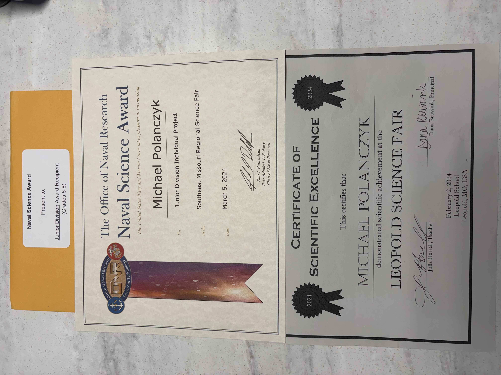

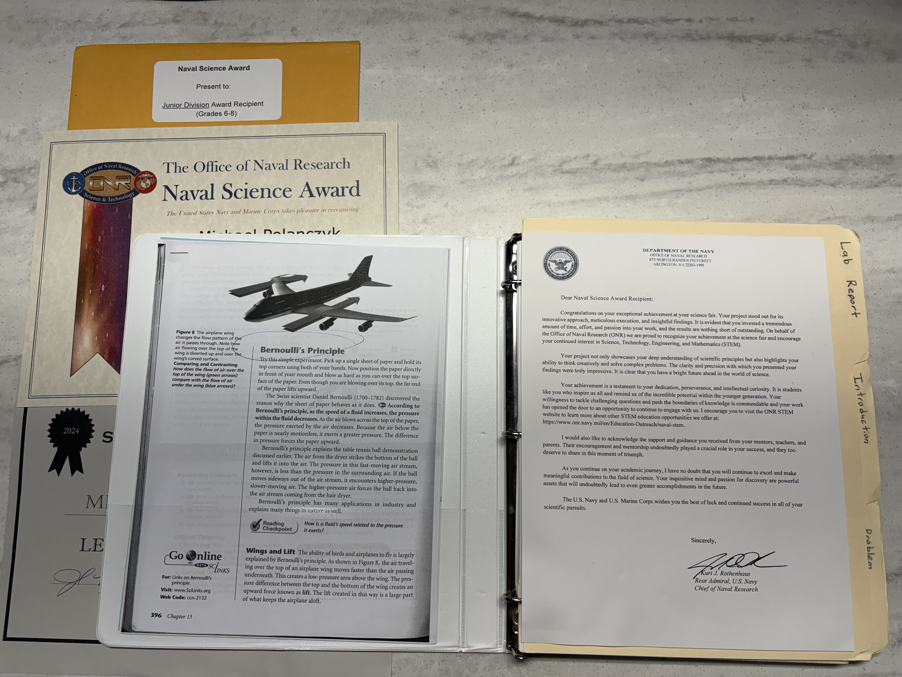

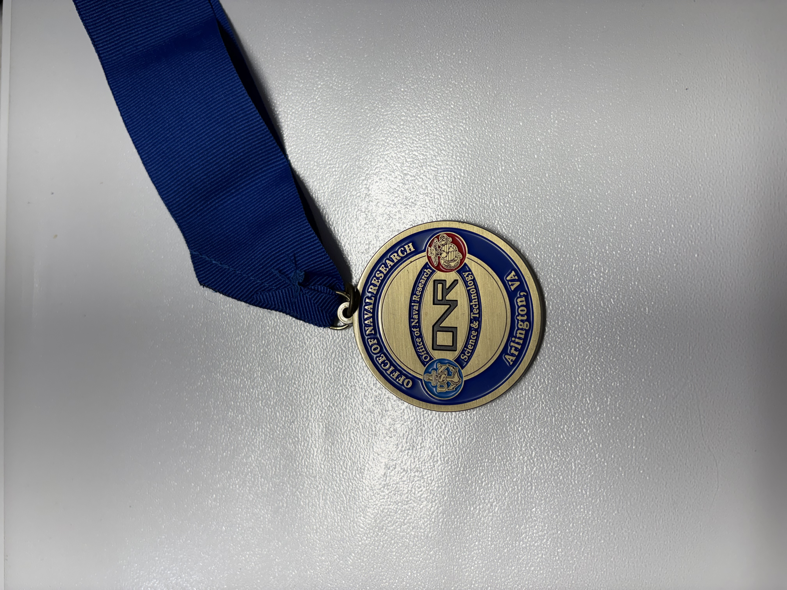

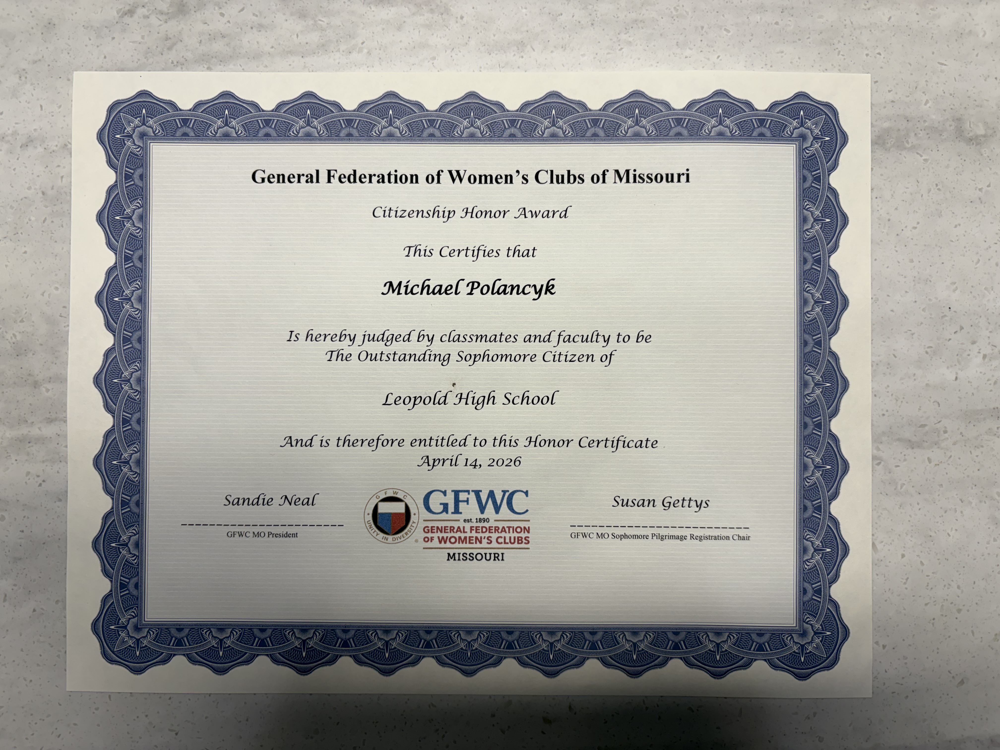

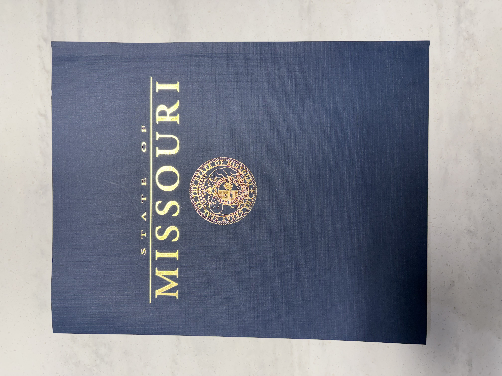

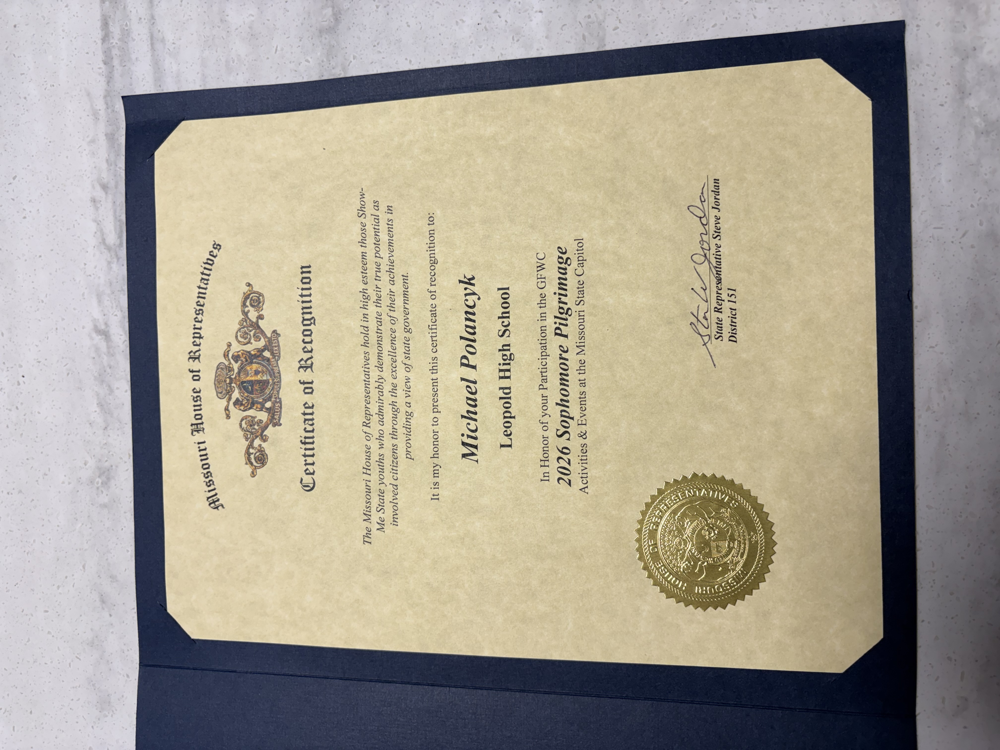

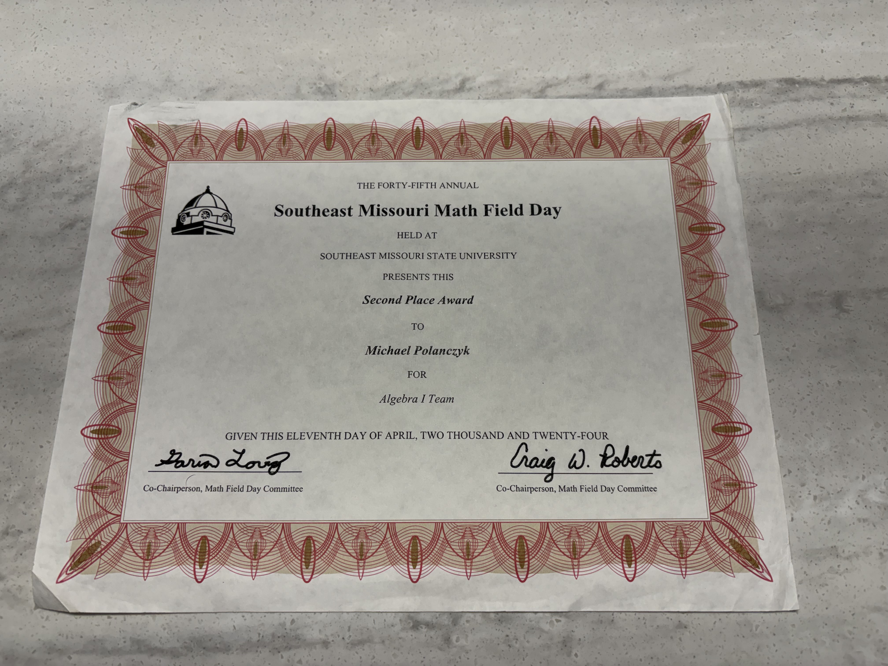

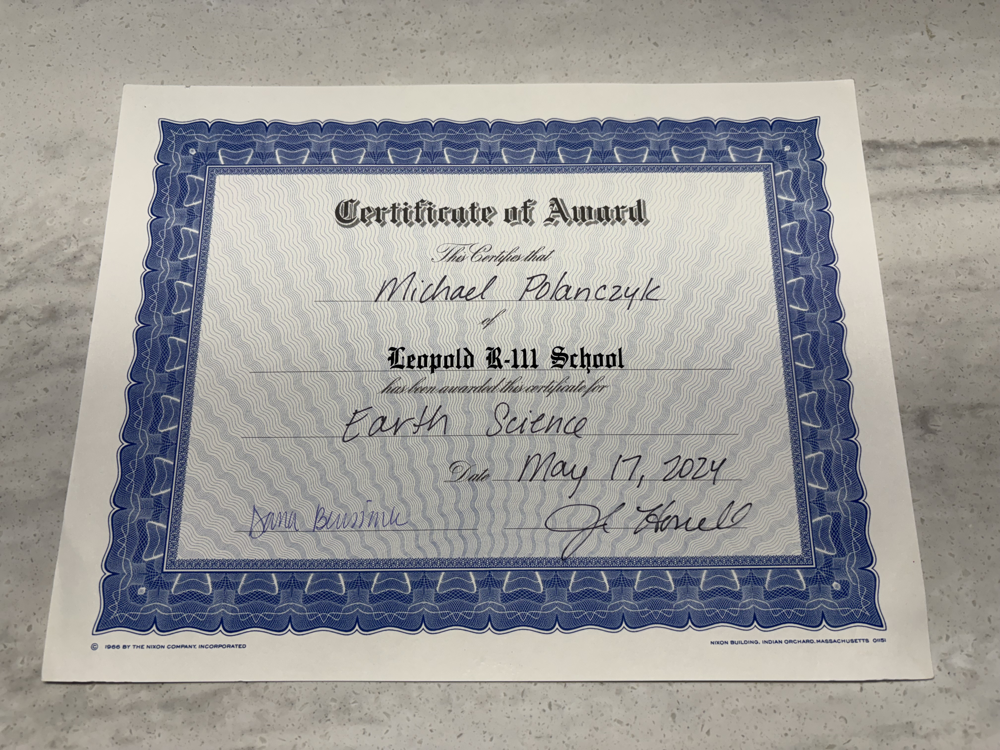

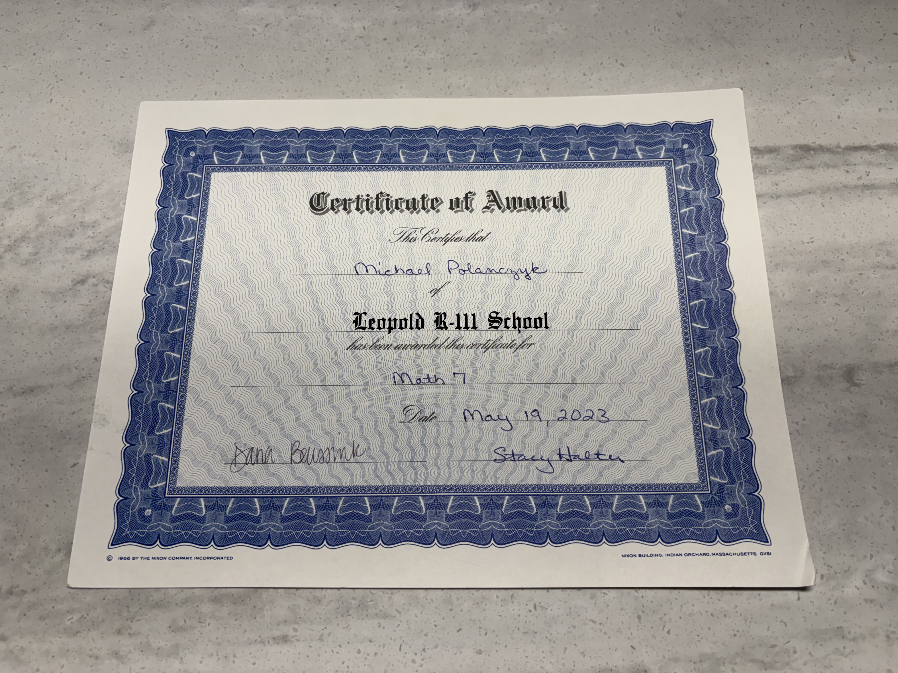

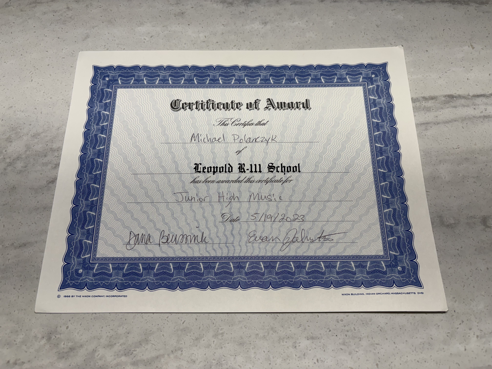

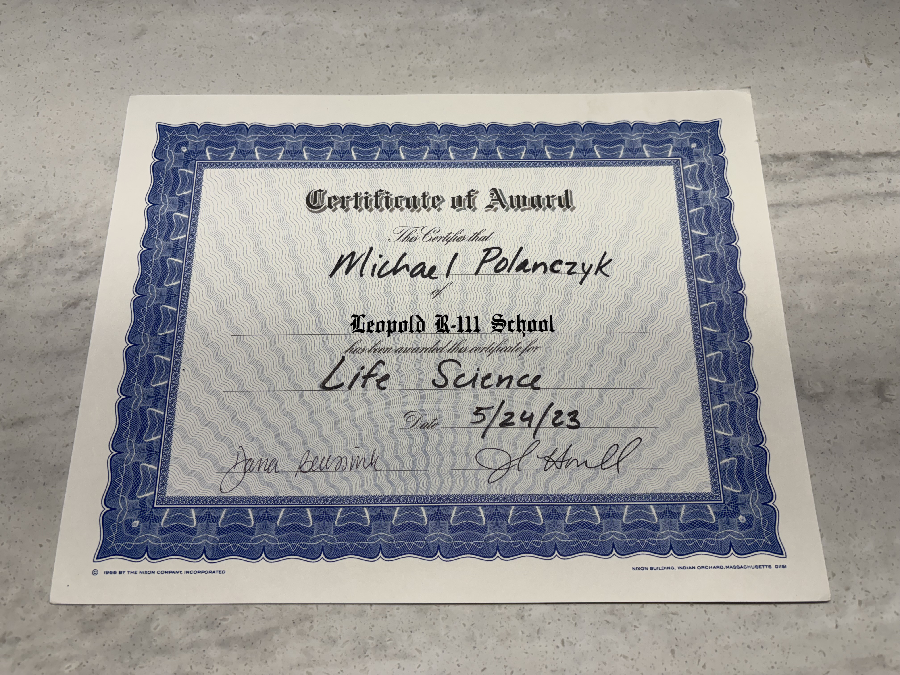

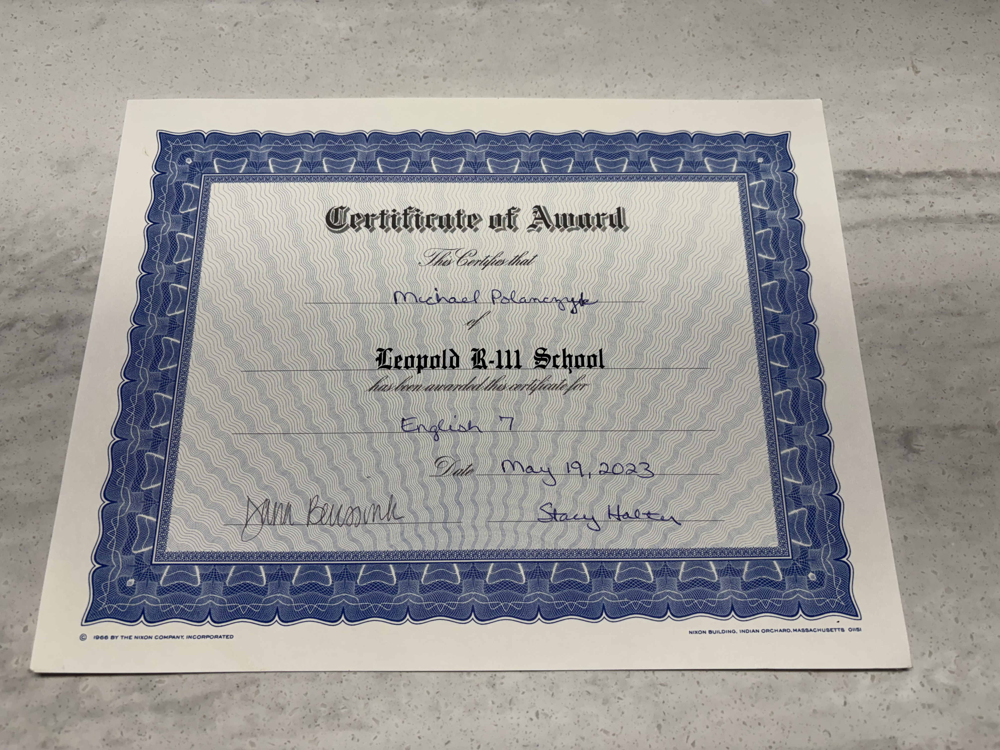

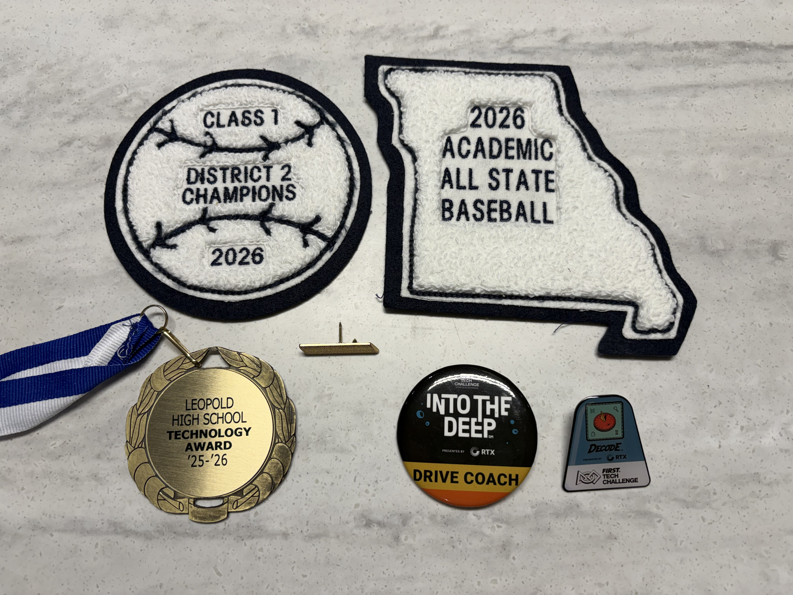

[Back to top](#awards-and-recognition) · [Baseball story and team photos](../sports.md)

## Photo rights

Images of certificates, medals, and other awards are presented as documentation of my achievements. Please do not reuse my original photographs without permission.
