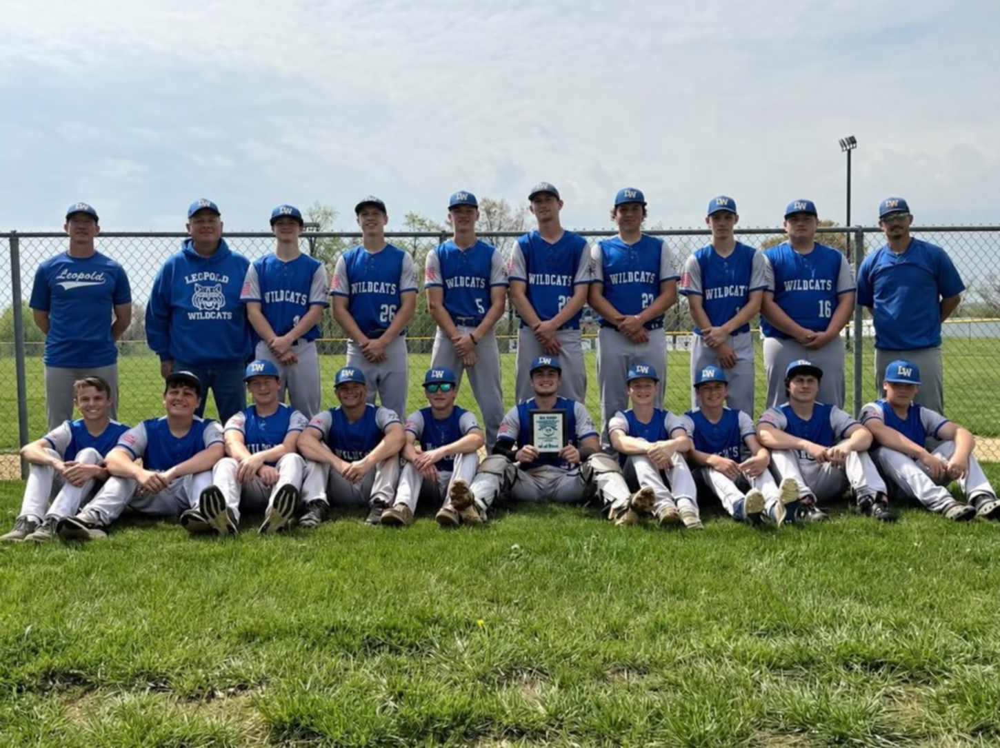
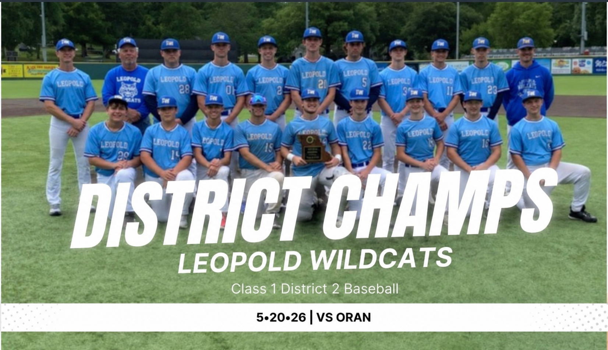

# Sports | Baseball

[Home](README.md) · [About me](about.md) · [Awards](awards/README.md) · [Engineering](engineering.md)

## Getting the chance to play

I had always wanted to be part of a sports team, but growing up in a hardworking family meant that there wasn't much time for organized sports. I finally got that opportunity during my sophomore year, when I joined the baseball team.

## My first season

I started in the fall of my sophomore year. I was completely new to playing on a team, so I spent that season learning the fundamentals, understanding the plays, and getting comfortable with the game.

I returned in the spring. I didn't get as much playing time as I would have liked, partly because the more experienced seniors were ahead of me. Still, being part of the team and watching how everyone worked together taught me a lot.

## A memorable spring

That spring, our team set new school and district milestones. We won our district championship and finished first at the Oak Ridge tournament. We then advanced to the playoffs, where our season ended with a disappointing loss at home.

Even though the season didn't end the way we hoped, I'm glad I finally had the chance to play. I got to learn a sport from the ground up, contribute as part of a team, and experience a season that meant a lot to our school.

## Recognition

- **2026 Class 1 District 2 baseball champions** — team championship
- **Oak Ridge tournament** — first place
- **Academic All-State baseball** — recognition documented in my [awards section](awards/README.md)

[Sports media folder](sports/media/README.md)

*Please don't reuse my original photographs without permission.*
